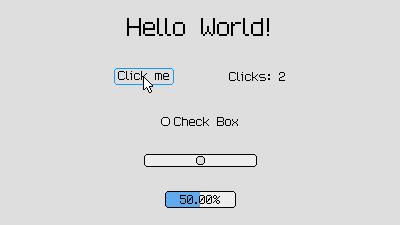

# libretro-gfxprim

A libretro core that acts as a [gfxprim](https://github.com/gfxprim/gfxprim) backend, so gfxprim applications render inside [RetroArch](https://www.retroarch.com) or any other libretro frontend. Video is sent to the frontend, and mouse, keyboard and joypad input is passed to gfxprim.



``` c
static void render(gp_pixmap* pixmap) {
	gp_pixel black = gp_rgb_to_pixmap_pixel(10, 10, 10, pixmap);
	gp_pixel red = gp_rgb_to_pixmap_pixel(230, 57, 70, pixmap);
	gp_pixel white = gp_rgb_to_pixmap_pixel(245, 245, 245, pixmap);
	gp_pixel blue = gp_rgb_to_pixmap_pixel(69, 123, 157, pixmap);
	gp_pixel orange = gp_rgb_to_pixmap_pixel(255, 161, 0, pixmap);

	gp_fill(pixmap, white);

	gp_fill_rect(pixmap, 100, 100, 20, 40, red);
	gp_fill_circle(pixmap, 200, 150, 30, blue);
	gp_line(pixmap, 250, 50, 230, 130, blue);
	gp_fill_triangle(pixmap, 60, 200, 130, 180, 90, 150, orange);

	gp_text(pixmap, NULL, pixmap->w / 2, 10, GP_ALIGN_CENTER | GP_VALIGN_BELOW, black, 0, "Hello World!");

	gp_fill_circle(pixmap, core.mouseX, core.mouseY, 10, core.mouseLeft == 1 ? red : orange);
}
```

## Controls

- Mouse
	- Left, Right and Middle buttons map to `GP_BTN_LEFT`, `GP_BTN_RIGHT` and `GP_BTN_MIDDLE`
	- Mouse uses relative movement, clamped to the screen
	- Pointer uses absolute coordinates, with a press acting as the left button. Select it with the *Mouse Device* core option.
- Keyboard
	- The full keyboard is passed through the libretro keyboard callback, including typed characters
- Joypad (port 1)

	| RetroPad | gfxprim key |
	| -------- | ----------- |
	| D-Pad    | `GP_KEY_LEFT`, `GP_KEY_RIGHT`, `GP_KEY_UP`, `GP_KEY_DOWN` |
	| A        | `GP_KEY_A` |
	| B        | `GP_KEY_B` |
	| X        | `GP_KEY_X` |
	| Y        | `GP_KEY_Y` |
	| Select   | `GP_KEY_RIGHT_SHIFT` |
	| Start    | `GP_KEY_ENTER` |
	| L        | `GP_KEY_PAGE_UP` |
	| R        | `GP_KEY_PAGE_DOWN` |

## Core Options

- `gfxprim_pixelformat` - Pixel Format: `16 Bit` (default), `32 Bit`. Requires a restart.
- `gfxprim_resolution` - Resolution: `320x240`, `400x225` (default), `480x272`, `640x360`, `640x480`, `800x600`, `960x540`, `1280x720`, `1920x1080`. Requires a restart.
- `gfxprim_mouse_device` - Mouse Device: `Mouse` (default, relative movement), `Pointer` (absolute coordinates)

## Compile

1. Ensure dependencies are available:
	- Python

2. Clone the code:
    ```
	git clone --recursive https://github.com/RobLoach/libretro-gfxprim.git
	cd libretro-gfxprim
	```
	For an existing clone, fetch the submodules with `git submodule update --init`.

3. Compile
	```
	make
	```
4. Run
    ```
	retroarch -L gfxprim_libretro.so
	```

GitHub Actions builds `gfxprim_libretro.so` as an artifact for pushes to `master` and pull requests, see [.github/workflows/build.yml](.github/workflows/build.yml).
